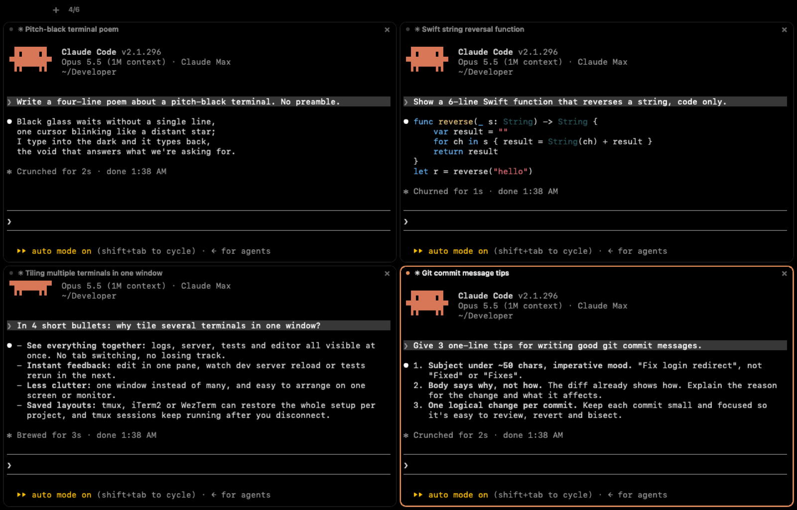
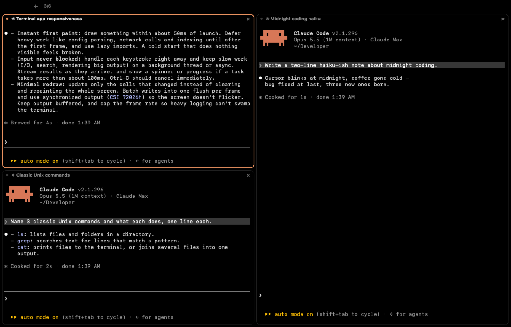

# Onyx

A fast, pitch-black macOS app that groups up to six normal terminals in one window. Each
terminal is exactly what Terminal.app gives you — your login shell started the same way, your
environment, your `gh`/git/vercel logins — except that `claude --permission-mode auto` is typed
for you at the first prompt. Ctrl-Z / `fg` work on it; quit Claude and you're in your shell.



## Use

| Key | Action |
|---|---|
| `⌘N` / `+` | New terminal (the 7th opens a new window) |
| `⌘⇧N` | New window |
| `⌘W` | Close terminal (asks first if Claude is answering or another program runs) |
| `⌘K` | Clear |
| `⌘C` / `⌘V` | Copy / paste |
| `⌘`-click | Open a link |
| `⌘1`…`⌘6` | Focus terminal |
| `⌘⌥←↑↓→` | Move focus |
| `⌘+` / `⌘-` / `⌘0` | Font bigger / smaller / default (11 pt) |

Layout follows the count: 1 full, 2 side by side, 3 = two stacked left + one right,
4 = 2×2, 5 = 2+2+1, 6 = 3×2. Drag the gaps to resize; adding or closing re-flows.
Drag a terminal by its header onto another's place to move it there; the ones in between
shift along (drop 3 on 1 in the three-pane layout and 1 moves down, 2 moves right).



New terminals start in `~/Developer` (home if it doesn't exist). Scrollback: 10,000 lines.
The selected terminal has an orange border. There is no scroll bar; scroll with the trackpad.
Each header shows the folder while the shell is in front, otherwise the running program's
own title — for Claude, the task it is working on, renamed as the task changes.
Closing the last window keeps Onyx running, like Terminal; click the Dock icon for a new one.

**Reopening.** Onyx keeps a record of what is open (`~/Library/Application Support/Onyx/session.json`,
updated every 2 s), so after quitting — or a force quit or crash — the next launch asks
"Reopen your last terminals?" and can bring back the same windows, terminals and order, each
Claude back in its conversation
(`claude --resume <id> --permission-mode auto`, in the folder Claude ran in). Which conversation
a terminal holds is read from Claude's own `~/.claude/sessions/<pid>.json`, so a Claude you
started yourself, or one after `/clear`, is followed too. A conversation with no messages yet
starts fresh, and if none had messages Onyx doesn't ask and just opens one terminal; programs other than Claude (dev servers, ssh) don't come back; a window you
close on purpose doesn't come back.

## Install

Needs macOS 14 or newer and Apple's Command Line Tools (`xcode-select --install`) or Xcode.
For terminals to start Claude, install [Claude Code](https://docs.claude.com/en/docs/claude-code)
so `claude` is on your PATH; without it each terminal is a plain shell.

```
git clone https://github.com/aakashnarukula-dev/onyx.git
cd onyx
scripts/bundle.sh          # builds (first time takes a few minutes, ~8 on a MacBook Air), installs /Applications/Onyx.app, pins it to the Dock
open /Applications/Onyx.app
```

The install pins Onyx to the Dock once (it never adds a second icon); set `ONYX_NO_DOCK=1` to skip that.

Built on your Mac, so Gatekeeper doesn't block it. To update: `git pull && scripts/bundle.sh`
(quit Onyx first). To uninstall: delete `/Applications/Onyx.app` and
`~/Library/Application Support/Onyx`.

New terminals start in `~/Developer`, or your home folder if that doesn't exist.

## Build

```
scripts/test.sh      # unit tests (Swift Testing)
scripts/bundle.sh    # release build -> /Applications/Onyx.app
```

SwiftTerm v1.20.0 is vendored in `Vendor/SwiftTerm` with its Metal shader left out of the
build (the Command Line Tools have no `metal` compiler; Onyx uses the CoreText renderer).

Test hooks (inert unless set): `ONYX_PANE_COMMAND`, `ONYX_SNAPSHOT` + `ONYX_SCRIPT`,
`ONYX_TIMING` — see `Sources/Onyx/DebugHooks.swift`.

## License

MIT — see `LICENSE`. SwiftTerm (in `Vendor/SwiftTerm`) keeps its own MIT license.
